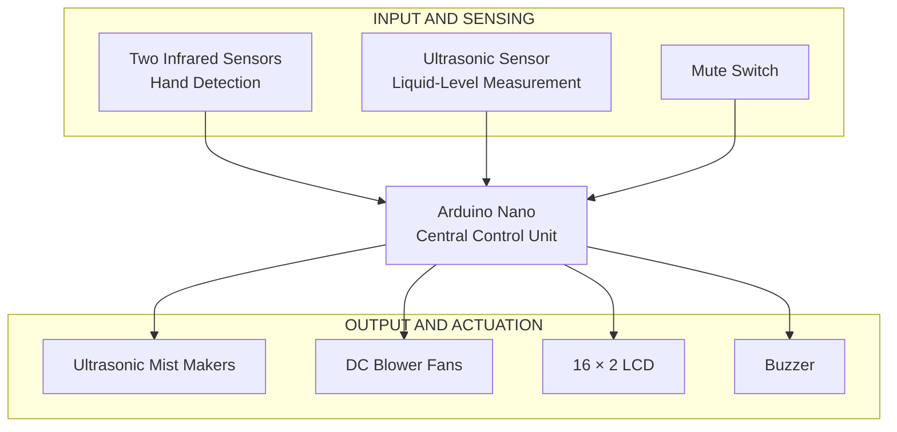

# System Block Diagram

## Overview

The automated hand-cleansing device consists of an input and sensing subsystem, a central control subsystem, and an output subsystem.

The Arduino Nano receives signals from the infrared hand-detection sensors, ultrasonic liquid-level sensor, and mute switch. It processes these inputs and controls the mist makers, blower fans, LCD, and buzzer.

## Block Diagram

## System Operation

1. The infrared sensors detect hand placement.
2. The ultrasonic sensor measures the liquid level in the reservoir.
3. The Arduino Nano processes the sensor inputs.
4. When the hand-detection and liquid-level conditions are satisfied, the mist makers operate for 15 seconds.
5. The mist makers switch off, and the blower fans operate for the remaining 5 seconds.
6. The LCD displays operating information, while the buzzer provides liquid-level alerts.

## Main Subsystems

| Subsystem | Components | Function |
|---|---|---|
| Input and sensing | Infrared sensors, ultrasonic sensor, mute switch | Detects hand placement and monitors liquid level |
| Control | Arduino Nano | Processes inputs and controls the operating sequence |
| Actuation | Mist makers and DC fans | Produces mist and provides drying airflow |
| User interface | LCD and buzzer | Displays system status and provides audible alerts |
